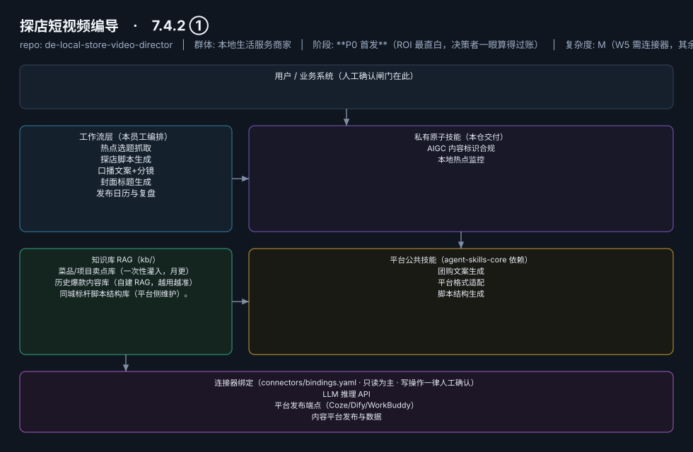
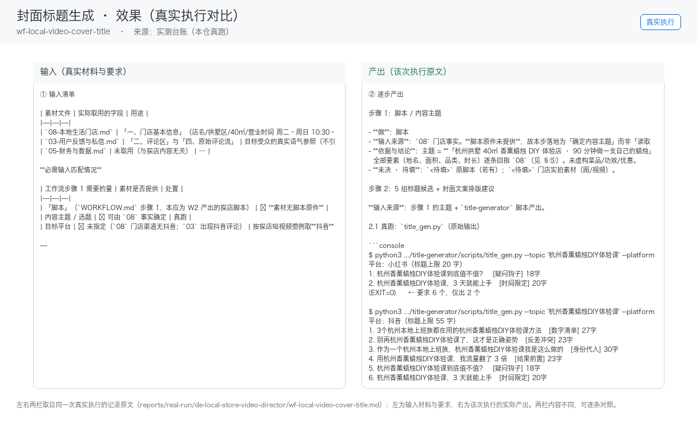

# 探店短视频编导

> 门店的"编外内容总监"：每天给出拍什么、怎么拍、怎么挂团购的完整答案
>
> **7.4.2 ①**　·　本地生活服务商家　·　阶段 **P0 首发**（ROI 最直白，决策者一眼算得过账）　·　
> 复杂度 M（W5 需连接器，其余 S）　·　300–2000 元/月（本地商家愿为 AI 批量内容付 500–2000 元/月，据 R4 调研）；**代配置服务加成：500–1500 元/次**（卖点库灌入+账号授权代办+首周陪跑，可占总成交额的 30–50%，本群体付费意愿最强的增值服务）　·　定义卡 7.4.2 ①

## 演示（真实执行录播）


*真实执行回放（GIF 自动循环，非摆拍）· [▶ 观看完整版 MP4](workflows/wf-local-video-cover-title/docs/images/08-demo-run.mp4) · 台账见 [`reports/real-run/wf-local-video-cover-title.md`](reports/real-run/wf-local-video-cover-title.md)*



## 效果（真实执行）



*上图为**真实效果对比**，不是示意图：左栏是输入材料与要求，右栏是该次执行的产出原文，
两栏取自同一次真实执行记录。*

- 完整台账：[`reports/real-run/wf-local-video-cover-title.md`](reports/real-run/wf-local-video-cover-title.md)
- 录屏与终端回放：[`workflows/wf-local-video-cover-title/docs/images/`](workflows/wf-local-video-cover-title/docs/images/)（`08-demo-run.gif` / `08-demo-run.mp4` / `04-terminal-run.png`）
- 使用示例：[`workflows/wf-local-video-cover-title/docs/使用示例.md`](workflows/wf-local-video-cover-title/docs/使用示例.md)
> 实测判定：**通过**　·　可用度 3/5　·　编造数字 0 处　·　红线命中 3 次 / 拦截 3 次


**一句话**：无内容团队的餐饮/美业/健身门店老板（71% 无专业内容团队，据 R4 调研）

---

## 这个数字员工解决什么问题

Mock 先行（提示词包即可交付 W1–W4）→ 云端定时推送（微信服务号/企微推送选题与脚本），无需门店本地部署。

| 项 | 内容 |
|---|---|
| 服务对象 | 无内容团队的餐饮/美业/健身门店老板（71% 无专业内容团队，据 R4 调研） |
| 可量化目标 | 周产出可用脚本 ≥5 条；老板单条素材加工耗时 ≤20 分钟；内容更新频率 ≥3 条/周 |
| 投入产出 | 替代 8000 元/月外包，省 75% 成本（据 R4 调研）；月省工时 ≥30 小时 |
| 需求依据 | D01、D21 |
| 分发渠道 | GitHub（必备）、**小红书**（目标老板聚集地，教程种草转化）、**抖音**（用产品产出的内容做自证营销）、Coze 扣子商店 |

## 30 秒上手

```bash
git clone <本仓库地址> && cd de-local-store-video-director
pip install pyyaml
python3 tests/run.py            # 先跑一遍自检，确认环境与契约都对得上
```

试用（把 `<输入>` 换成本人真实材料）：

```text
请以「探店短视频编导」的身份，帮我跑「热点选题抓取」。
材料如下：<输入>
要求：只使用材料里出现过的数字，缺的写 <待填>；对外文案停在待确认状态。
```

详细接入见 [`docs/01-安装与接入.md`](docs/01-安装与接入.md)。

## 仓库结构

```text
de-local-store-video-director/
├── employee.md            # 人读定义卡（12 主字段 + 2 扩展组，由 employee.yaml 生成）
├── employee.yaml          # 机器契约（能力清单 + 依赖锁）
├── dependencies.yaml      # 对 core 的外部依赖（含版本）
├── persona/               # 运行提示词 / 边界 / KPI
├── skills/                # 私有原子技能（2 个）
├── spec-bindings/         # 有意不公共化能力的本地绑定声明（0 个）
├── workflows/             # 本员工工作流（5 条）
├── kb/                    # 知识库 RAG 契约
├── connectors/            # 连接器绑定（只读为主，写操作人工确认）
├── docs/                  # 六类发布文档
└── tests/                 # 自动化多场景测试
```

## 私有原子技能（2）

| 技能 | slug | 复杂度 | 阶段 | 成熟度 |
|---|---|---|---|---|
| `AIGC 内容标识合规` | `aigc-labeling-compliance` | S | P0 | 契约完备 |
| `本地热点监控` | `local-trend-monitor` | M | P0 | 契约完备 |

## 平台公共技能依赖（3）

| 技能 | slug | 全平台复用员工数 |
|---|---|---|
| `团购文案生成` | `groupbuy-copy-writer` | 2 |
| `平台格式适配` | `platform-format-adapter` | 6 |
| `脚本结构生成` | `script-structure` | 3 |

> 这些技能来自 `agent-skills-core@1.0.0`，本仓库**只引用不复制**。

## Spec 绑定层（0）

（无）

> 这一族能力**有意不公共化**（与外部平台接口强绑定）。本仓不存正文，
> 只留本地绑定声明与连接器配置。

## 工作流（5）

| 工作流 | slug | 触发 | 阶段 | 调用技能数 |
|---|---|---|---|---|
| `热点选题抓取` | `wf-local-video-hot-topic` | 定时（每日 7:00） | P0 | 1 |
| `探店脚本生成` | `wf-local-video-script` | 人工（老板投喂素材照片/语音描述） | P0 | 1 |
| `口播文案+分镜` | `wf-local-video-oral-storyboard` | 人工（随 W2 联动） | P0 | 1 |
| `封面标题生成` | `wf-local-video-cover-title` | 人工 | P0 | 1 |
| `发布日历与复盘` | `wf-local-video-review` | 定时（每周一） | P1 | 2 |

## 知识库与连接器

- 知识库语料：['菜品/项目卖点库（一次性灌入，月更）', '历史爆款内容库（自建 RAG，越用越准）', '同城标杆脚本结构库（平台侧维护）。']
- 连接器：LLM 推理 API、平台发布端点（Coze/Dify/WorkBuddy）、内容平台发布与数据

## 质量与验收

| 项 | 值 |
|---|---|
| 技能文件数 | 160 |
| 多场景用例数 | 205 |
| 用例通过 | 205 |
| 验收结论 | ✅ 通过 |

完整报告：[`docs/05-验收与测试.md`](docs/05-验收与测试.md)

## 许可

专有许可，详见 [`LICENSE`](LICENSE)。
