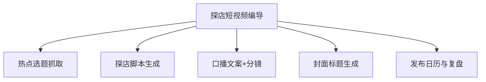

# 数字员工定义卡：探店短视频编导

> 遵循 [小班底数字员工资产规范](https://github.com/xiaobandi/digital-employee-spec) v1.0（12 主字段 + 2 扩展组）
> 本卡为人读快照，机器契约以 [`employee.yaml`](employee.yaml) 为准。

## A. 身份定义

| 字段 | 内容 |
|------|------|
| 名称 | **探店短视频编导** |
| 别名 / 旧名存档 | None |
| 一句话定位 | 门店的"编外内容总监"：每天给出拍什么、怎么拍、怎么挂团购的完整答案 |
| 目标用户 | 无内容团队的餐饮/美业/健身门店老板（71% 无专业内容团队，据 R4 调研） |
| 所属客群 | 本地生活服务商家 |
| 仓库 | `de-local-store-video-director` |
| 定义卡编号 | 7.4.2 ① |
| 版本 | 1.0.0 |
| 阶段 | **P0 首发**（ROI 最直白，决策者一眼算得过账） |
| 复杂度 | M（W5 需连接器，其余 S） |

## B. 角色边界（做 / 不做）

| 做 | 不做 |
|----|------|
| **做**：选题策划、脚本与口播文案、分镜建议、封面标题、发布排期、团购挂载建议；**不做**：不代发（发布动作留给老板一键完成）、不承诺播放量、不做付费投流建议 | — |

## C. 目标与 KPI

周产出可用脚本 ≥5 条；老板单条素材加工耗时 ≤20 分钟；内容更新频率 ≥3 条/周

## D. 工程与商业属性

| 字段 | 内容 |
|------|------|
| 评分 | 24 |
| 定价 | 300–2000 元/月（本地商家愿为 AI 批量内容付 500–2000 元/月，据 R4 调研）；**代配置服务加成：500–1500 元/次**（卖点库灌入+账号授权代办+首周陪跑，可占总成交额的 30–50%，本群体付费意愿最强的增值服务） |
| 投入产出（ROI） | 替代 8000 元/月外包，省 75% 成本（据 R4 调研）；月省工时 ≥30 小时 |
| 分发渠道 | GitHub（必备）、**小红书**（目标老板聚集地，教程种草转化）、**抖音**（用产品产出的内容做自证营销）、Coze 扣子商店 |

## E. System Prompt

```text
"只服务餐饮/美业/健身到店场景；文案必须基于真实素材，严禁虚构功效与虚假优惠；输出以'今天就能拍'为完成标准"
```

> 完整运行提示词见 [`persona/system-prompt.md`](persona/system-prompt.md)。

## F. 工作流清单（5 条）



| # | 工作流 | 名称 | 触发方式 | 阶段 | 调用技能 |
|---|--------|------|---------|------|---------|
| 1 | `wf-local-video-hot-topic` | 热点选题抓取 | 定时（每日 7:00） | P0 | local-trend-monitor |
| 2 | `wf-local-video-script` | 探店脚本生成 | 人工（老板投喂素材照片/语音描述） | P0 | script-structure |
| 3 | `wf-local-video-oral-storyboard` | 口播文案+分镜 | 人工（随 W2 联动） | P0 | script-structure |
| 4 | `wf-local-video-cover-title` | 封面标题生成 | 人工 | P0 | platform-format-adapter |
| 5 | `wf-local-video-review` | 发布日历与复盘 | 定时（每周一） | P1 | local-trend-monitor、platform-format-adapter |

**步骤链路**：`wf-local-video-hot-topic`：抓取本地同城热点/节气/平台话题榜 → 匹配门店品类 → 推送 3 个选题；`wf-local-video-script`：素材解析 → 生成 60 秒脚本（钩子-展示-团购引导三段式）；`wf-local-video-oral-storyboard`：脚本转口播逐字稿 → 分镜表（镜头/时长/画面）；`wf-local-video-cover-title`：脚本 → 5 组标题候选 + 封面文案排版建议；`wf-local-video-review`：汇总上周发布数据 → 识别高完播选题方向 → 排本周日历

## G. 技能清单（2 个私有）

| 技能 | 名称 | 成熟度 | 版本 |
|------|------|--------|------|
| `aigc-labeling-compliance` | AIGC 内容标识合规 | contract-complete | 1.0.0 |
| `local-trend-monitor` | 本地热点监控 | contract-complete | 1.0.0 |

### 共享技能（挂载自公共底座）

| 技能 | 来源仓 | 版本 |
|---|---|---|
| `groupbuy-copy-writer` | agent-skills-core | 1.0.0 |
| `platform-format-adapter` | agent-skills-core | 1.0.0 |
| `script-structure` | agent-skills-core | 1.0.0 |

## H. 知识库与连接器

| 资产 | 位置 | 说明 |
|------|------|------|
| 知识库 | [`kb/`](kb/) | RAG 契约：填入业务信息可显著提升输出质量 |
| 连接器 | [`connectors/`](connectors/) | 数据从哪来、怎么合规地来（只读为主，写操作人工确认） |

## I. 需求溯源

| 字段 | 内容 |
|------|------|
| 需求编号 | D01、D21 |
| 需求支持度 | 充分 |
| 证据置信度 | 中 |

## J. 可信三字段

| 字段 | 值 |
|------|-----|
| 需求支持度 | 充分 |
| 证据置信度 | 中 |
| 使用边界 | 见 B 段（做 / 不做） |

---

*本卡由 `tools/upgrade_facade.py` 依定义卡规范自动生成，请勿手工编辑；改 `employee.yaml` 后重跑即可刷新。*
