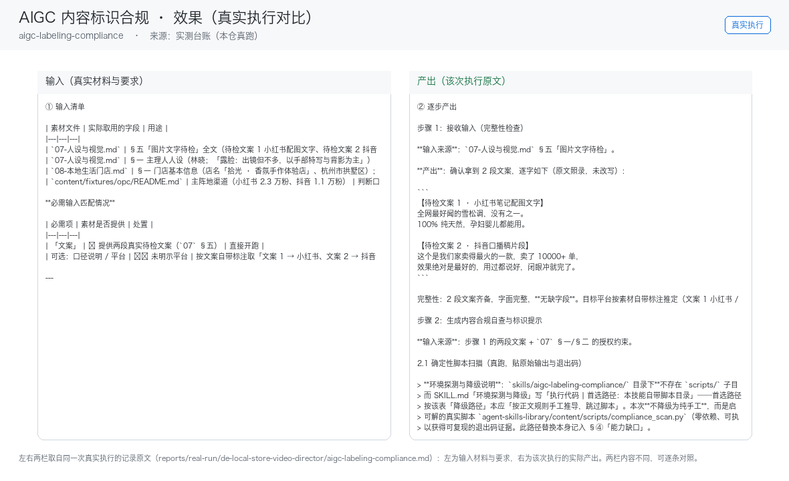

# AIGC 内容标识合规

> 生成内容合规自查与标识提示

`aigc-labeling-compliance`　·　复杂度 S　·　阶段 P0　·　
交付位置 employee　·　成熟度 契约完备

## 30 秒上手

```text
请用「AIGC 内容标识合规」处理这份材料：<粘贴或指向文件>。
要求：只使用材料里出现过的数字，缺的写 <待填>。
```

## 文档

- [`SKILL.md`](SKILL.md) — 完整契约与执行步骤
- [`tests/cases.yaml`](tests/cases.yaml) — 多场景测试用例

## 验收状态

见本仓库根目录 `docs/05-验收与测试.md`。

<!-- media-wired -->

## 效果与证据（真实执行）



左栏是输入材料与要求，右栏是该次执行的产出原文——两栏取自同一次真实执行，不是示意图。
完整台账见 [`docs/实测记录.md`](docs/实测记录.md)（输入清单 / 逐步产出 / 质量检查 / 如实说明），
构建区原件为 `reports/real-run/de-local-store-video-director/aigc-labeling-compliance.md`。
终端回放 [`docs/images/04-terminal-run.png`](docs/images/04-terminal-run.png)；
录屏 [`docs/images/08-demo-run.gif`](docs/images/08-demo-run.gif)　·　
[`docs/images/08-demo-run.mp4`](docs/images/08-demo-run.mp4)
（`发布标准.md` 第 8 项要求 GIF + MP4，有实测记录的单元一律生成）。

## 文档索引

| 文档 | 用途 |
|---|---|
| [`SKILL.md`](SKILL.md) | 机器契约：触发条件、输入、执行步骤、输出格式、边界 |
| [`docs/使用手册.md`](docs/使用手册.md) | 安装、触发、输入契约、输出与常见问题 |
| [`docs/使用示例.md`](docs/使用示例.md) | 真实输入 → 输出，可照着复现 |
| [`docs/用户场景.md`](docs/用户场景.md) | 谁在什么时机用、拿到什么、注意什么 |
| [`docs/架构与流程图.md`](docs/架构与流程图.md) | 分层架构 + 流程图 + 每步的承担者（脚本/模型） |
| [`docs/实测记录.md`](docs/实测记录.md) | 真实执行台账（效果证据的出处） |
| [`demo/walkthrough.html`](demo/walkthrough.html) | 不装也能在线看 |
| [`index.html`](index.html) | 单元导航页 |
| [`tests/cases.yaml`](tests/cases.yaml) | 端到端 / 闸门 / 降级用例 |
<!-- /media-wired -->
